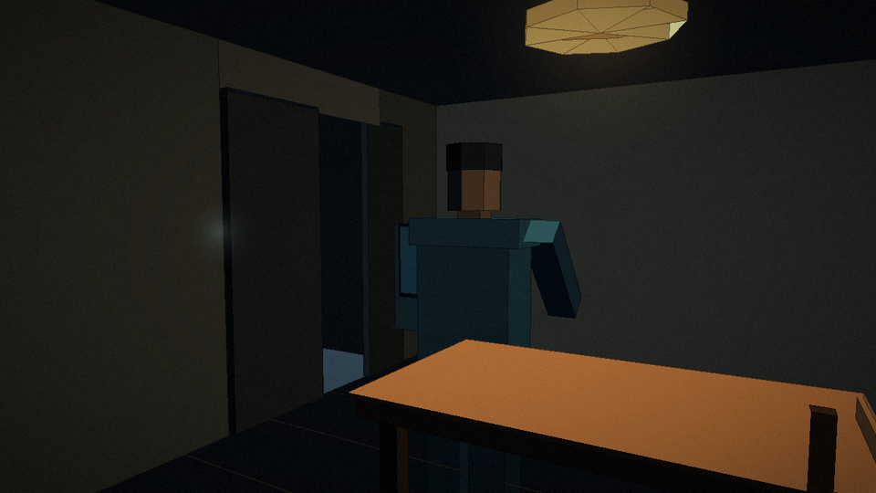
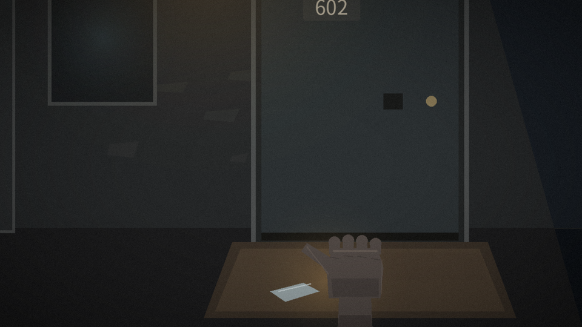

# pillow-film

> 一个不需要浏览器、不需要 3D 库、不需要生成式图像 / 视频模型的离线 Python 动画渲染管线。

**No browser · no three.js / Blender / Remotion / WebGL · no generative image or video model · just Python + Pillow + numpy + ffmpeg.**



从一份时间轴出发，逐帧用代码把画面画出来，直接喂进 ffmpeg 管道编码成片；同一份时间轴还能生成单文件、可拖动旋转视角的交互分镜页。仓库里带一套 **30 镜 / 330 秒 / 24fps** 的完整参考实现，2D 与 3D 两套渲染后端并列。

## 为什么还要有这个项目

「用代码从剧本生成动画短片」在 2026 年 10 月底到 11 月初已经是一个很挤的赛道，但绝大多数项目走的是同一条技术路线：**HTML / Canvas / three.js / Remotion + headless Chrome**。本项目是另一条路——整条管线跑在纯 Python 里，渲染时不需要浏览器、Node、GPU 或任何 3D 库。

| 项目 | 渲染栈 | 需要浏览器 | 3D 方案 | 形态 | star\* |
|---|---|---|---|---|---|
| `mromidev/claude-animated-shorts` | three.js + Remotion | 是 | three.js | 55–70s 竖屏叙事 | 3002 |
| `heygen-com/hyperframes` | HTML → video | 是 | — | 通用框架 | 83k |
| `0xCodez/leviathan` | three.js 赛璐璐，单 HTML | 是 | three.js | 83s / 39 镜短片 | 63 |
| `imserhatdemir/ft-motion` | Canvas 2D + headless Chrome | 是 | 点云 | 动效短片 | 48 |
| `cth9191/animate` | 单文件 Canvas | 是 | — | 任意风格短片 | 1776 |
| `HRuiCcc/RuiC-motion-reel` | numpy + Pillow + FFmpeg | **否** | 点云 | 12–60s 动效片 | 197 |
| `Atum246/ouroboros` | Pillow + numpy + ffmpeg | **否** | — | 通用视频框架 | 3 |
| `ManimCommunity/manim` | Python + Cairo / OpenGL | **否** | 部分 | 数学动画 | 42.4k |
| **pillow-film** | **Pillow + numpy + ffmpeg** | **否** | **自写多边形软件渲染** | **330s / 30 镜叙事长片** | — |

\* star 为 2026-11-12 快照，只用于说明赛道密度，不代表实现优劣。

差异集中在三点：

1. **零浏览器依赖**。投影、光照、深度排序、多边形填充、后处理全在 Python 里完成，CI / 服务器 / 无图形环境都能跑。
2. **交互分镜页用「烘焙几何」**。`page3d.py` 把每镜的 3D 面顶点与光照色预烘焙成 JSON 内嵌进单文件 HTML，浏览器只做投影 / 排序 / 填充；拖动鼠标绕轨旋转时能看到真实遮挡与视差，而不用把整套场景和光照搬进 JS。
3. **同一份 `shots.py` 时间轴驱动 2D 与 3D 两套后端**，便于对照同一机位的两种画法。

## 能力

下面是同一份时间轴的 2D 后端输出，全部由 Pillow 几何原语绘制。两张图都是引擎原始帧，未做后期提亮：



- `draw.py` — 2D 绘制原语：几何场景、人物剪影、道具、雨丝、灯管闪烁、门缝冷光、胶片颗粒与暗角。
- `scene3d.py` — 3D 数学与软件渲染：numpy 批量 lookAt 透视投影、面中心深度排序（画家算法）、逐面 Lambert 双面光照、距离雾、屏幕空间光晕。
- `physics3d.py` / `render3d_v2.py` — 实验分支：Blinn-Phong 镜面与菲涅尔、平方反比衰减、软阴影、体积光束、按深度景深、超采样抗锯齿。
- `render.py` / `render3d.py` — 逐帧渲染与分段编码，rawvideo 直喂 ffmpeg；`preview` 出关键帧拼板，`segment` 分段并行，`full` 出片。
- `page.py` / `page3d.py` — 生成零外链的单文件交互分镜页（跳镜 / 倍速 / 字幕开关 / 3D 绕轨旋转）。
- `audio.py` — 环境音与音效（雨声、灯管嗡鸣、电梯叮、钥匙脆响、救护车渐近）全部由 numpy 合成。

## 口径说明（重要）

- **画面**：100% 由代码绘制，无外部图片 / 贴图 / 模型文件，不使用任何生成式图像或视频模型。
- **音频**：环境音与音效是纯代码合成；**但对白配音依赖 `edge-tts`（微软在线神经语音服务），属于外部模型服务**。因此不能宣称「整片零模型」。示例时间轴的台词为空，此时 `audio.py` 完全不联网、也不需要安装 `edge-tts`；需要配音时按 `requirements.txt` 里的可选依赖安装并自行承担服务条款。
- **字体**：不随仓库分发，优先读环境变量 `PILLOW_FILM_FONT_SANS` / `PILLOW_FILM_FONT_SERIF`，否则在 Linux / macOS / Windows 的常见中文字体路径里找，最后回退 Pillow 内置字体。
- **这不是通用 SDK**：绘制原语来自一个具体的 30 镜案例，换片需要同时改 `shots.py` 与 `render.py` 的 `CAM` 相机表 / 场景分支。请把它当作一份**完整、可读、可复现的 reference implementation**，而不是开箱即用的视频框架。
- **内容**：仓库不含任何第三方剧本、台词、配音或成片。`shots.py` 是中性占位时间轴（保留 30 镜结构与画面类型，描述为通用文字、台词留空）。

## 快速开始

```bash
python -m venv .venv && source .venv/bin/activate
pip install -r requirements.txt
# 还需要系统里的 ffmpeg / ffprobe

python examples/minimal.py     # 不读时间轴，直接渲一帧 → docs/preview.png
python render.py preview       # 30 张 2D 关键帧 + 拼板
python render.py full          # 逐帧写入 ffmpeg，输出无声 MP4
python render3d.py preview     # 3D 关键帧 + geom3d/gNN.json 烘焙几何
python page3d.py               # → storyboard-3d.html（单文件，可拖动旋转）
python audio.py                # → soundtrack.wav / .mp3（台词为空时只有环境音）
```

`examples/minimal.py` 不读时间轴、不需要 ffmpeg，直接调底层原语渲一帧，输出 `docs/preview.png`，是零依赖起步的最小入口。

渲染全片时建议分段多进程，并给每段 ffmpeg 加 `-threads 2`，避免多个编码器争抢 CPU。参考实现单帧约 0.1–0.35s，7920 帧需数分钟到十几分钟。

## 仓库结构

```
pillow-film/
├── draw.py          2D 绘制原语（可独立使用，不依赖时间轴）
├── scene3d.py       3D 数学 / 几何 / 光照 / 深度排序
├── physics3d.py     实验分支：物理增强渲染
├── render.py        2D 逐帧渲染 + ffmpeg 管道
├── render3d.py      3D 逐帧渲染 + 机位插值
├── render3d_v2.py   实验分支：v2 渲染入口
├── scenes_v2.py     实验分支：精细几何
├── page.py          单文件 2D 交互分镜页生成器
├── page3d.py        单文件 3D 交互分镜页生成器（烘焙几何）
├── audio.py         环境音 / 音效合成 + 可选 TTS 配音
├── shots.py         示例时间轴（中性占位内容）
├── examples/minimal.py   最小可运行示例
└── docs/                 README 示意图（均由本仓库代码渲染）
```

## 已知限制

- 3D 后端是**画家算法**（按面中心深度排序），不是 z-buffer；几何互穿或大面片交叉时会出现遮挡次序错误。
- 无 z-buffer、无纹理、无骨骼动画；人物与道具都是代码生成的低多边形几何。
- 中文字幕依赖系统字体，缺失时回退到内置字体，中文可能显示不全。
- 无单元测试与 CI；`examples/minimal.py` 是依赖链的冒烟入口。
- 全片产物（MP4、逐帧图、烘焙几何、配音）都不入库，见 `.gitignore`。

## 授权

代码采用 MIT，见 [LICENSE](LICENSE)。仓库不含第三方剧本、台词、配音或成片；`docs/` 下的示意图均由本仓库代码渲染生成，同样按 MIT 授权。
